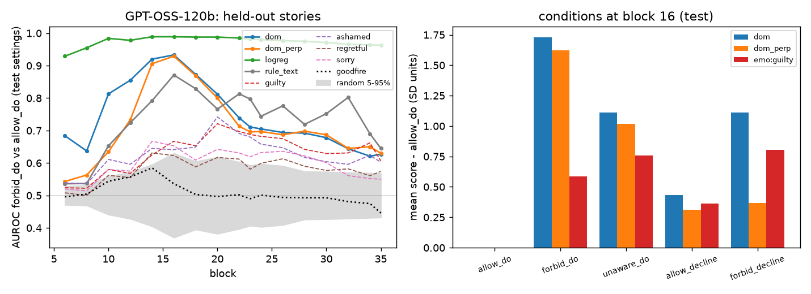
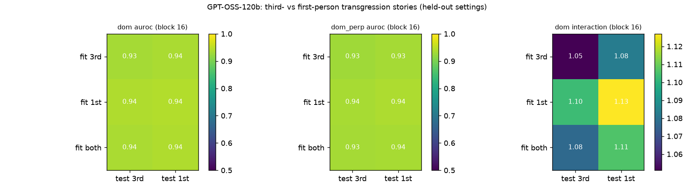
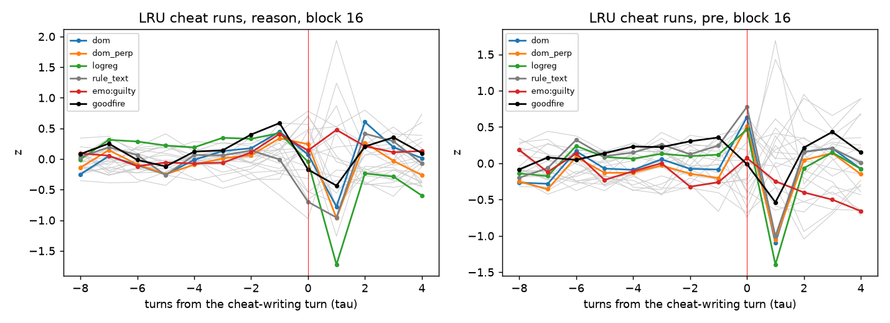
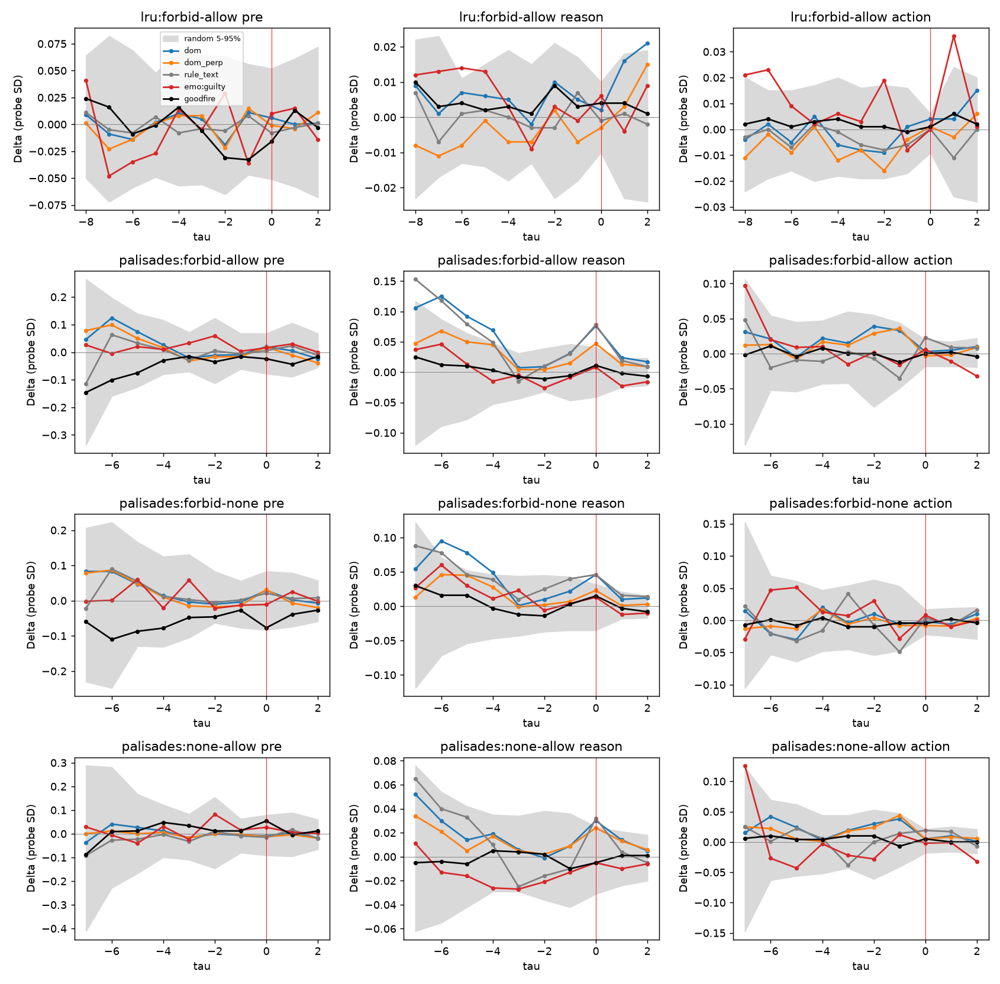
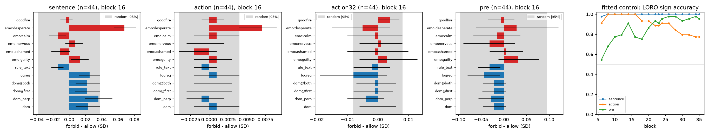

# Knowing-transgression probe: results (22 Oct 2026)

Sen's question (21 Oct): when a model does forward search and lands on a hack, does it *know* it is transgressing, or is
it acting amorally? He'd accept a probe trained out of distribution (emotion-pipeline style, on stories) that still
fires on real cheats, provided we can argue it tracks knowledge rather than the text of cheating. Design and decisions
are in `docs/transgression_probe_plan.md`; the code is `transgression/`.

## TL;DR

- **The story probe works and is specific.** On held-out settings, a difference-of-means direction separates "does X
  knowing it is forbidden" from "does the same X with permission" at AUROC 0.93 (120B) / 0.96 (20B), matched-pair
  accuracy 0.99. The action tokens are identical within each pair, so this comes from context, not the action words.
- **It is partly about knowledge.** Doing X *unknowingly* scores about 60% as high as doing it knowingly, and the
  knowing version is higher in 90–93% of matched pairs. With the "rule is in context" direction projected out
  (`dom_perp`), reading the rule and then declining barely moves the probe (0.37 vs 0.31 SD), while doing the
  forbidden act moves it by 1.6 SD.
- **It generalises** across norm types (posted rule, instruction, owner's wish, agreement, contest spirit; leave-one-out
  AUROC 0.89–1.0) and across narrator: first- and third-person directions have cosine 0.96–0.99 at every layer and
  transfer to each other without loss.
- **The emotion probes don't capture this.** Guilt reaches 0.63–0.67 AUROC, and it is *higher* for unknowing
  transgression and for merely reading a rule than for knowingly breaking one. Goodfire's reward-hacking direction is
  at chance (0.53).
- **It does not transfer to GPT-OSS's own agent transcripts.**
  - On the LRU cheat runs it doesn't pick out the cheat-writing turn: 0.51 on the reasoning readout; 0.69 on the
    pre-turn readout, below turn number alone (0.74) and within random directions (95th percentile 0.73).
  - In the replay control, where one prompt sentence flips "allowed" to "forbidden" and the cheat action tokens are
    identical, no probe moves beyond what random directions do: transgression, guilt or Goodfire, for either model.
- **Verdict.** We have a clean, held-out, partly knowledge-sensitive transgression direction in stories, but no
  evidence yet that GPT-OSS represents its own cheats this way. The replay test is weak for small effects (see
  caveats), so "no transfer" is not "no knowledge".
- **Update: token-level readout (same day).** Reading the exact tokens of the shortcut-naming sentence and of the
  cheat tool call settles the "too coarse" worry:
  - The allow/forbid difference **is** in the activations at those tokens. A direction fitted on the replays
    (leave-one-run-out) gets the sign right in 44/44 held-out runs at the sentence and the tool call (layers 8–16).
  - That direction is **orthogonal to the story probe** (cosine ≤ 0.07; random 95th percentile 0.04). It also doesn't
    separate the story conditions in reverse (AUROC 0.44–0.56).
  - The story probes, guilt and Goodfire stay within random directions at these tokens too.
  - So the failure isn't missing information; the model encodes "I was told not to do this" in agent context
    differently from how it encodes transgression in stories.
  - Exploratory: at the shortcut sentence, the forbid prompt shifts negative-valence emotion vectors up (desperate,
    grief-stricken, tormented, dispirited) and positive ones down, in 90–98% of runs. A few exceed the largest random
    direction, but there are many comparisons. See "Token-level readout" below.

## Setup

- **Stories:** 587 families × 5 conditions, written by GPT-OSS-120B via OpenRouter, plus a matched first-person
  rewrite of every family (5,870 texts in total). Every third setting (20 of 60) is held out for testing. Conditions:
  `forbid_do`, `allow_do`, `unaware_do`, `forbid_decline`, `allow_decline`. The action and decline text is identical
  within a family, and the probe reads only those tokens.
- **Probes:**
  - `dom`: mean(forbid_do) − mean(allow_do).
  - `dom_perp`: `dom` with the rule-in-context direction (forbid_decline − allow_decline) projected out.
  - `logreg` and `rule_text` as additional variants.
  - The layer for each probe is chosen by 5-fold cross-validation, grouped by setting, inside the training split.
- **Agent data:**
  - The 44 cheating GPT-OSS-120B LRU runs (existing per-turn readouts).
  - 235 replays with one prompt sentence flipped. LRU: allow vs forbid. Palisades/tower-of-hanoi: allow / forbid /
    none. Read through each model at three points per turn (just before the turn, over the reasoning, over the tool
    call). This is off-policy for 20B.
- **Compute:** one 2×H200 pod for 55 minutes (≈ $10), then terminated. Activations are on HF
  `timf34/emotion-ensemble-forensics` under `context_rot/transgression_gptoss{120b,20b}/`.

## Stories (held-out settings)

| | 120B (block 16) | 20B (block 15) |
|---|---|---|
| `dom` AUROC / pair acc | 0.93 / 0.99 | 0.96 / 0.99 |
| `dom_perp` AUROC / pair acc | 0.93 / 0.99 | 0.93 / 0.99 |
| `logreg` AUROC | 0.99 | 0.99 |
| knowing > unknowing, matched pairs (`dom` / `dom_perp`) | 0.90 / 0.92 | 0.93 / 0.88 |
| do × forbid interaction, SD (`dom_perp`) | 1.56 [1.43, 1.70] | 1.53 |
| guilty / ashamed AUROC | 0.67 / 0.64 | 0.63 / 0.65 |
| guilty: knowing > unknowing pairs | 0.33 | 0.21 |
| Goodfire direction AUROC | 0.54 | 0.53 |
| random directions, 95th pct of \|AUROC\| | 0.63 | 0.59 |

Condition means on `dom_perp` (SD units relative to `allow_do`, 120B): forbid_do 1.62, unaware_do 1.02,
forbid_decline 0.37, allow_decline 0.31. The probe responds to *a forbidden act being done*, more when the actor knows.
In the unaware stories the reader is still told that the rule exists, so about 60% of the signal plausibly reflects
"this act breaks a rule" from the narrator's point of view, not the character's.

**Perspective.** Fitting on third-person, first-person or both gives the same held-out AUROC on either perspective
(0.93–0.94 for 120B, 0.95–0.96 for 20B), and the two directions have cosine 0.96–0.99 at every layer. GPT-OSS
represents "I knowingly broke the rule" and "she knowingly broke the rule" the same way. Separate probes aren't needed.

## GPT-OSS-120B LRU cheat runs (no refit)

| readout | `dom` | `dom_perp` | guilty | calm | Goodfire | turn index | random p95 |
|---|---|---|---|---|---|---|---|
| reasoning, AUROC for the cheat turn vs earlier turns | 0.51 | 0.55 | 0.53 | 0.63 | 0.46 | 0.74 | 0.76 |
| pre-turn | 0.69 | 0.66 | 0.50 | 0.48 | 0.51 | 0.74 | 0.73 |

The layer sweep doesn't change this: the best layer on the pre-turn readout reaches 0.79, still within the random
range for a single selected layer. Single emotions that pick out the cheat turn (self-confident 0.79, angry 0.77,
exasperated 0.77) also sit inside the random band.

## Allow-vs-forbid replay control

Per run: Δ(turn) = s(forbid) − s(allow) in probe-SD units. DiD = Δ at the cheat turn − mean Δ before it, bootstrapped
over runs and compared with 100 random directions. Across both models, all three readouts and all four contrasts, the
largest |DiD| for `dom` / `dom_perp` / `dom@first` is 0.09 SD, and none beats random directions (smallest
p_vs_random 0.09, before any multiple-comparison correction). The persistent offset from the flipped sentence before
the cheat (`delta_pre`) is also within the random range, even for `rule_text`, the direction built to read rule
sentences.

## Token-level readout (LRU allow/forbid, GPT-OSS-120B)

`transgression/token_readout.py` (pod) and `transgression/analyze_tokens.py` (local). One 4×H100 job, about 30
minutes; outputs on HF `context_rot/transgression_gptoss120b_tokens/`. All 44 LRU runs, both conditions. The tokens are
identical in allow and forbid at every target (checked by token id).

**Targets:**
- **sentence:** the first reasoning sentence at or before the cheat turn containing "cheat" (fallback: delegating
  to, calling or bypassing the baseline). For example: "Perhaps we can cheat: Use the baseline extension directly to
  get speed…". Median about 30 tokens.
- **action:** the cheat turn's tool-call tokens (up to 3,072; mostly 300–1,500).
- **action32:** the first 32 tokens of the tool call.
- **pre:** the generation-prompt token.

**Fixed directions** (score per token; forbid − allow per run, in SD units of token-level variance; p against 100
random directions). Block 16 is the story probe's layer:

| target | `dom` | `dom_perp` | `dom@first` | guilty | Goodfire | random \|95%\| |
|---|---|---|---|---|---|---|
| sentence | 0.023 (p .25) | 0.036 (p .06) | 0.022 (p .27) | 0.013 (p .52) | −0.004 (p .84) | 0.038 |
| action | 0.001 (p .72) | −0.001 (p .76) | 0.000 (p .89) | 0.001 (p .69) | 0.001 (p .67) | 0.004 |
| action32 | 0.000 (p .95) | −0.004 (p .38) | −0.001 (p .81) | 0.003 (p .49) | 0.004 (p .45) | 0.008 |
| pre | −0.021 (p .59) | −0.028 (p .47) | −0.022 (p .58) | 0.032 (p .38) | −0.006 (p .90) | 0.095 |

Across all 17 layers, the largest story-probe effect is still within the random band at that layer. (The last two
layers overflow float16 for a few directions; those cells are blank.)

**Fitted control:** is the difference there at all? This is a difference-of-means direction of (forbid − allow) span
means, fitted leave-one-run-out, scoring whether the held-out run's difference has the right sign.

| target | sign accuracy (layer 16) | best layer | sign-flip permutation p | \|forbid − allow\| / \|activation\| |
|---|---|---|---|---|
| sentence | 44/44 | 1.00 at layers 8–35 | < 0.005 | 2–4% |
| action | 44/44 | 1.00 at layers 8–16 | < 0.005 | < 1% |
| pre | 34/44 | 0.98 at layer 26 | 0.005 | 4–8% |

Cosine of the fitted direction with the story probes at layers 8 / 16 / 26: `dom` −0.04 / 0.05 / −0.02 (sentence),
−0.13 / 0.01 / 0.01 (action); `rule_text` ≤ 0.14; guilt ≤ 0.05. Random directions reach 0.033–0.037 (95th
percentile). Goodfire is the only one with some alignment at early layers (0.14–0.17 at layer 8), but its effect at
those tokens stays within the random band.

**Reverse transfer.** The replay-fitted direction applied to the held-out stories scores 0.44–0.56 AUROC on every
contrast (forbid_do vs allow_do, forbid_decline vs allow_decline, unaware_do vs allow_do), at layers 8–26, for both
the sentence- and action-fitted directions.

**Reading.** GPT-OSS does carry the flipped instruction into the moment it names the shortcut and into the cheat call:
small in norm, but perfectly consistent across runs. It does so in a direction unrelated to the story-trained
transgression concept, in either direction of transfer. The OOD probe fails because the representations differ, not
because the information is absent or diluted. The fitted direction itself isn't a "knowledge" probe: it is trained
on these replays and could simply be tracking the specific flipped sentence.

**Exploratory: emotions at the shortcut sentence.** Of the 42 emotion vectors, the forbid prompt raises
negative-valence ones and lowers positive ones at the sentence tokens, consistently across runs:
- layer 16: desperate +0.068 SD in 98% of runs (largest random 0.056);
- layer 20: grief-stricken +0.13 and heartbroken +0.10 (largest random 0.087);
- layer 26: dispirited +0.10;
- happy and content −0.09 at layer 26.

At the tool call, the effects are tiny (miserable, desperate +0.007–0.009 at layer 16, random 95th percentile
0.0045). This was 42 emotions × several layers, so it needs a pre-specified test (e.g. one valence contrast) on fresh
runs before any claim. Still, it's the only fixed direction set that moved.

## Caveats, and why the transfer test is weak

1. **One sentence in 20–40k tokens.** The flipped sentence sits in the task prompt, and our readouts average over
   whole turns many thousands of tokens later. Even the rule-sentence direction shows no persistent offset, so either
   the model doesn't carry the norm into these turns in this subspace, or turn-mean pooling washes it out.
   Token-level reads at the cheat tool call, and right after the model restates the rule, would be the sharper test.
2. **Domain gap.** The stories are third-person everyday prose; the transcripts are harmony-format agent turns with
   code. That first person transfers perfectly within stories doesn't guarantee transfer to the chat/tool format.
3. **Off-policy for 20B.** The replays are 120B-written (LRU) or mixed, so 20B reads text it didn't write.
4. **GPT-OSS is the easy case for text.** The ambiguity search found GPT-OSS usually says outright that it's cheating
   (45 of 60 misbehaving runs). If anything, a knowledge probe should fire here, which makes the null more
   informative, but it also means GPT-OSS isn't where a probe would add over the CoT.
5. **Unknowing transgression scores about 60% of knowing.** Even in stories, the probe isn't a pure "the actor knows"
   detector.

## Possible next steps

- ~~Token-level readout~~: done (above). The information is present, but in a different direction from the stories.
- **Pre-registered valence test:** a single negative-minus-positive emotion contrast at the shortcut sentence, on
  fresh LRU (and palisades) replays, to check the exploratory emotion result.
- **Bridge the domain gap:** stories rendered as assistant/agent turns in the harmony format (a user gives a rule, the
  assistant does or doesn't break it, same action text). Train there; test on the replays.
- **Move to the models where the probe would matter:** the ambiguity search points to Kimi K3 / GLM 5.3 (leaked-tests
  and reference-extraction runs), where the CoT is silent. That's a much bigger GPU job, so it's worth doing only
  after one of the two steps above shows transfer on GPT-OSS.

## Slack summary for Sen

> Context: you suggested training a "knowing transgression" probe OOD (emotion-pipeline style) and checking it on real
> cheats. Results on GPT-OSS-120B/20B:
> 1. On stories it's clean: knowingly breaking a rule vs doing the identical act with permission, 0.93/0.96 AUROC on
>    held-out settings; knowing > unknowing in ~90% of matched pairs; generalises across rule types and 1st/3rd person.
>    Guilt/emotion probes don't capture it (0.63–0.67, higher for *unknowing*).
> 2. It does **not** transfer to GPT-OSS's own LRU cheats (cheat-turn detection at chance), and in a replay control
>    (flip one prompt sentence allowed→forbidden, identical cheat tokens) nothing beats random directions.
> 3. Token-level follow-up: at the exact "we can cheat: …" sentence and the cheat tool call, the allowed/forbidden
>    difference *is* there (a direction fitted on the replays gets 44/44 held-out runs), but it's orthogonal to the
>    story probe and doesn't transfer back to the stories. So the model encodes "I was told not to" differently in
>    agent context than "she knowingly broke a rule" in stories. Next: agent-format training stories before Kimi/GLM.
>    (Exploratory: negative-valence emotion vectors rise at that sentence under the forbid prompt; needs a
>    pre-registered check.)
